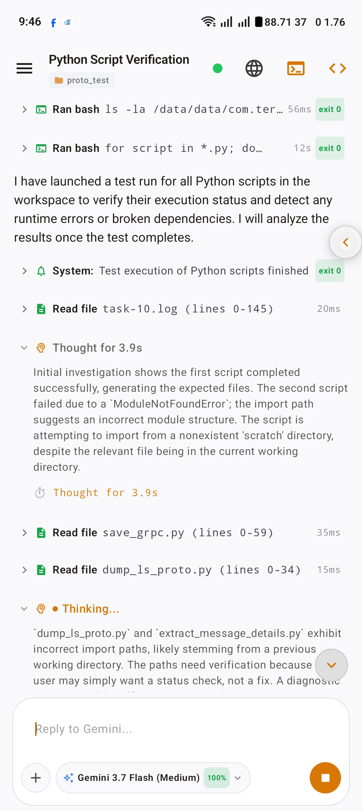
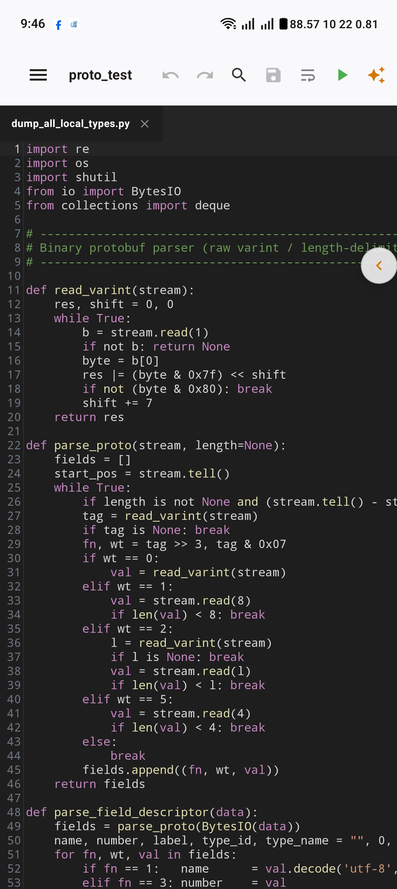
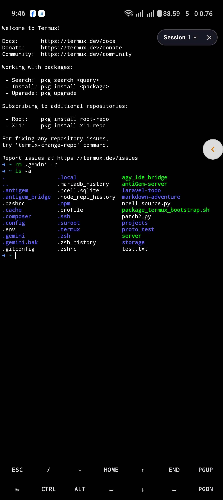
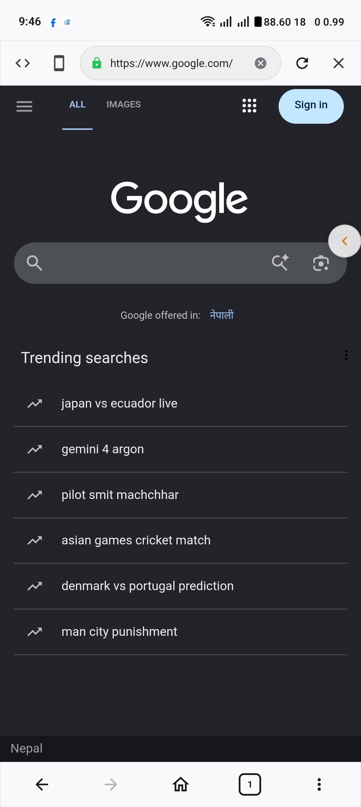
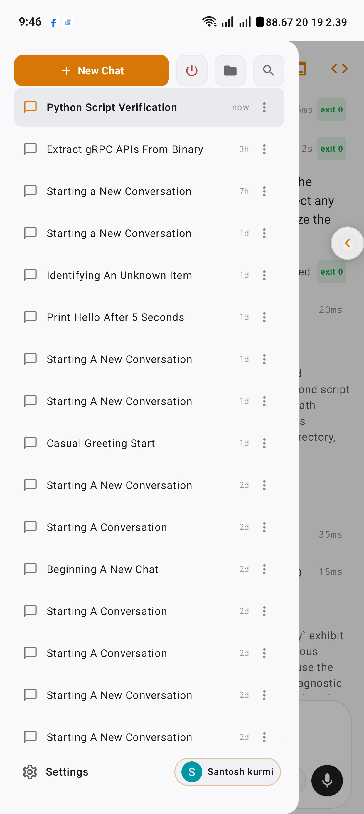
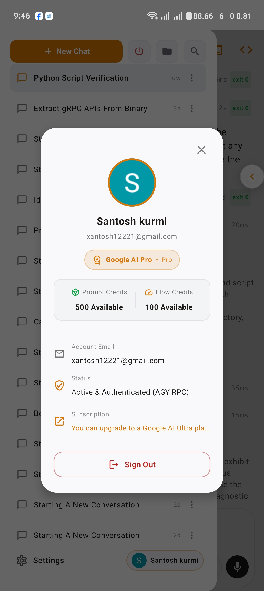
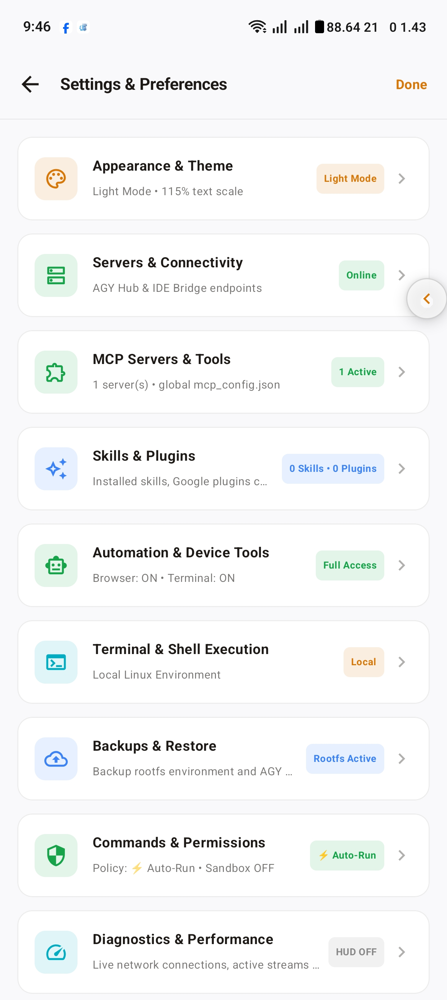

<div align="center">

# Gravent

**An intelligent, multi-agent AI coding workspace engineered for Android.**
*Featuring native Google Antigravity, Claude Code, and GitHub Copilot engines, a full Linux environment, code editor, and developer browser.*

[](https://developer.android.com/jetpack/compose)
[](https://go.dev)
[](LICENSE)
[](https://github.com/Rp0708/Gravent/releases)

[Download APK](https://github.com/Rp0708/Gravent/releases) &middot; [Architecture](#architecture) &middot; [Features](#features) &middot; [Plugin SDK](extension_docs/README.md) &middot; [Build Guide](#building-from-source)

</div>

---

## Overview

Gravent is a native Android development environment designed for agentic pair programming. Rather than wrapping web interfaces or scraping terminal output, Gravent interfaces directly with official agent protocol streams (gRPC and stream-json) to render real-time collapsible thinking trees, interactive tool approvals, diff viewers, and subagent state.

The application natively integrates three major coding backends:

- **Google Antigravity (`agy`)**: Direct high-throughput gRPC communication with the local `agy` language daemon, offering subagent execution, tool approvals, and live account quota telemetry.
- **Anthropic Claude Code**: The official `claude` CLI running directly inside the local Linux environment, streaming structured JSON events per conversation session with support for custom third-party providers (OpenRouter, DeepSeek, Kimi).
- **GitHub Copilot**: Native Copilot chat completions and intelligent code generation with automatic subscription tier detection (Copilot Pro and Business) and streaming token parsing.

---

## Screenshots

<table>
  <tr>
    <td align="center" width="25%"><br><sub>Agent Chat</sub></td>
    <td align="center" width="25%"><br><sub>Code Editor</sub></td>
    <td align="center" width="25%"><br><sub>Linux Terminal</sub></td>
    <td align="center" width="25%"><br><sub>Developer Browser</sub></td>
  </tr>
  <tr>
    <td align="center"><br><sub>Workspace History</sub></td>
    <td align="center"><br><sub>Account &amp; Quota</sub></td>
    <td align="center"><br><sub>Settings &amp; Tools</sub></td>
    <td></td>
  </tr>
</table>

---

## Architecture

Gravent connects Jetpack Compose Android UI to local background processes via an embedded Go bridge (`agy_ide_bridge`):

```text
+------------------------------------------------------------------+
|                        Gravent Android App                       |
|   Compose UI -- React Bits Prompt Bar -- Editor -- Browser -- MCP |
+---------------------------------+--------------------------------+
                                  | Local WebSocket / gRPC
+---------------------------------v--------------------------------+
|                    agy_ide_bridge (Local Go)                     |
|      Git Host -- File System -- Claude Relay -- Plugin Manager   |
+-----------------+-------------------------------+----------------+
                  | gRPC                          | stream-json
+-----------------v---------------+ +-------------v----------------+
|     Antigravity (agy) Daemon    | |       Claude Code CLI        |
|   Language Server & Subagents   | |  Isolated Session per Chat   |
+---------------------------------+ +------------------------------+
```

---

## Features

### Prompt Bar & Interaction Architecture
- **React Bits Prompt Bar**: Micro-interaction chat composer with dark zinc container, `"Ask anything..."` text field, and morphing squircle send/stop state button.
- **Actions Popover**: Quick floating action menu for direct photo/media upload, document selection, live web search (`@web`), workspace file referencing (`@`), slash commands (`/`), and voice dictation.
- **Interactive Effort Slider**: Real-time stepped reasoning budget control (`Off`, `Low`, `Med`, `High`) with smooth physics spring thumb tracking and direct preference synchronization.
- **Model Selector Pill**: Displays active provider model, remaining quota percentage, and dropdown switcher.

### Multi-Agent Engines
- **Antigravity**: Direct gRPC connection to `agy`, multi-agent coordination, subagent status tracking, automatic command execution rules, and security permission sandboxing.
- **Claude Code**: Native CLI installation and update management, Anthropic Console and subscription authentication, context window utilization monitoring, and prompt-cache telemetry.
- **GitHub Copilot**: Device-flow authentication, dynamic model availability based on active account entitlement (GPT-4o, Claude 3.5 Sonnet, o3-mini), and conversation persistence.
- **Third-Party Providers**: Route Claude Code sessions through any Anthropic-compatible API endpoint (OpenRouter, DeepSeek, Kimi, local LLMs).

### Linux Terminal & Environment
- **Native Execution**: Standalone Termux-based Linux environment with `pkg`/`apt`, bash, Python, Node.js, Go, Rust, and Git. Runs at native binary speeds without proot overhead.
- **ADB Connect**: Automated pairing and connection to the device's Wireless Debugging interface via loopback network for root-like automation.
- **Background Persistence**: Dedicated foreground service maintains long-running builds, servers, and scripts when the application is backgrounded.

### Built-in Model Context Protocol (MCP) Suite
Gravent includes built-in MCP servers accessible to all active agents with one-tap configuration toggles:

| Server | Capabilities |
| :--- | :--- |
| **Browser** | Automate headless or visual browser tabs, navigate URLs, inspect DOM trees, execute JavaScript, capture screenshots, and query console logs. |
| **Terminal** | Spawn background shells, execute build commands, capture streaming output, monitor exit codes, and manage process lifecycles. |
| **Android** | Query accessibility node trees, dispatch touch and gesture events, send keystrokes, launch applications, and inspect device state. |
| **Notes & Tasks** | Create, query, modify, and manage local task lists and structured notes directly from conversational prompts. |
| **Stitch** | Visual UI design prototyping and layout generation via Google Stitch. |
| **Custom Plugins** | User-installed extensions written against the Gravent Plugin API. |

### Code Editor & Source Control
- Multi-tab file editor supporting syntax highlighting for over 20 programming languages.
- In-editor terminal access with hardware keyboard modifiers (Ctrl, Alt, Esc, Tab).
- Integrated Git client: status inspection, unified visual diffs, branch switching, stage/commit, and remote push/pull.

### Built-in Developer Browser
- Local developer server preview (`localhost:3000`, `localhost:8080`, etc.).
- Embedded Eruda developer console for DOM inspection, network monitoring, and script debugging.
- Desktop and mobile viewport toggles with steady identity persistence for OAuth workflows.

---

## Download & Installation

Pre-built signed releases are available on the [GitHub Releases](https://github.com/Rp0708/Gravent/releases) page.

| Variant | Package Identifier | Architecture | Description |
| :--- | :--- | :---: | :--- |
| **Termux Shared** *(Recommended)* | `com.termux` | arm64-v8a | Self-contained native Linux rootfs. Shares Linux UID with the Termux:API companion app for hardware sensor access. |
| **Standalone** | `com.termux` | arm64-v8a | Self-contained native Linux rootfs without shared user ID constraints. |

> [!IMPORTANT]
> Because Gravent's native environment compiles against the standard Termux prefix (`/data/data/com.termux/files/usr`), it utilizes the `com.termux` package identifier to run pre-compiled binaries at full native speed without proot performance degradation. To install Gravent, uninstall any existing official Termux build on the device first, or backup and transfer existing configuration files.

### Termux:API Hardware Integration

Gravent natively provides core device management commands without external dependencies:

| Utility | Status | Description |
| :--- | :---: | :--- |
| `termux-toast` | Native | Display transient Android toast alerts |
| `termux-clipboard-get` / `-set` | Native | Read and write system clipboard contents |
| `termux-vibrate` | Native | Control device vibration haptics |
| `termux-torch` | Native | Toggle rear camera flashlight |
| `termux-tts-speak` | Native | Text-to-speech voice synthesis |
| `termux-notification` | Native | Dispatch and clear status bar notifications |
| `termux-battery-status` | Native | Query power connection, percentage, and temperature |
| `termux-open` / `termux-open-url` | Native | Launch files and URLs via Android intent dispatch |
| `termux-wake-lock` / `-unlock` | Native | Prevent CPU sleep during background execution |

For advanced hardware sensors (camera, location, telephony, Wi-Fi scanning), install the signed companion app from the [Termux:API Releases](https://github.com/Santoshkurmi/termux-api/releases) alongside the **Termux Shared** build.

---

## Building from Source

### Prerequisites
- **JDK:** OpenJDK 21 or newer
- **Android SDK:** API 35 (Platform Tools & Build Tools 35.0.0)
- **Go:** Go 1.23 or newer (required for cross-compiling the bridge binary)

### Compilation

```bash
git clone https://github.com/Rp0708/Gravent.git
cd Gravent

# Compile the release APK
./gradlew assembleTermuxRelease

# Or compile the debug build
./gradlew assembleTermuxDebug
```

Compiled APK artifacts will be placed in `app/build/outputs/apk/termux/`.

---

## Repository Structure

```text
Gravent/
├── app/src/main/
│   ├── java/com/example/gemini/
│   │   ├── data/          # Backends: Antigravity gRPC, Claude Code CLI, Copilot API, ADB
│   │   ├── domain/        # State models, token budgeting, and protocol definitions
│   │   └── ui/            # Jetpack Compose UI: Chat, Prompt Bar, IDE, Terminal, Settings
│   ├── java/com/termux/   # Native terminal emulation widgets and system services
│   └── assets/            # Browser runtime and extension host environment
├── agy_ide_bridge/        # Local Go bridge daemon: protocol multiplexer, Git, process relay
├── extensions/            # Bundled plugins and tools
├── extension_docs/        # Plugin SDK documentation, API specs, and tutorials
├── proto_generator/       # Protobuf generator scripts and schema definitions for agy
├── scripts/               # CI/CD automation, APK packaging, and backup scripts
└── version.json           # In-app updater version registry and release changelog
```

---

## Privacy & Security

Gravent is designed with a local-first architecture:
- All conversations, terminal outputs, source files, and credentials are stored strictly on-device in the app's protected private directory.
- Model credentials (Google Tokens, Claude OAuth tokens, GitHub Copilot PATs, custom API keys) remain local and are transmitted exclusively to their respective official provider endpoints over TLS.
- Gravent utilizes [TelemetryDeck](https://telemetrydeck.com) strictly for aggregate anonymous active install counts and OS version breakdown. It does **not** collect prompts, responses, source code, file names, terminal transcripts, emails, or credentials.

---

## License

Copyright (C) 2026 Santosh Kurmi. Licensed under the [GNU General Public License v3.0](LICENSE) or any later version.
